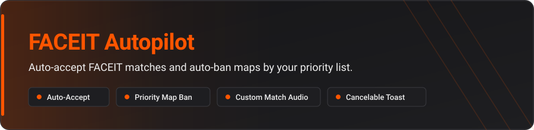
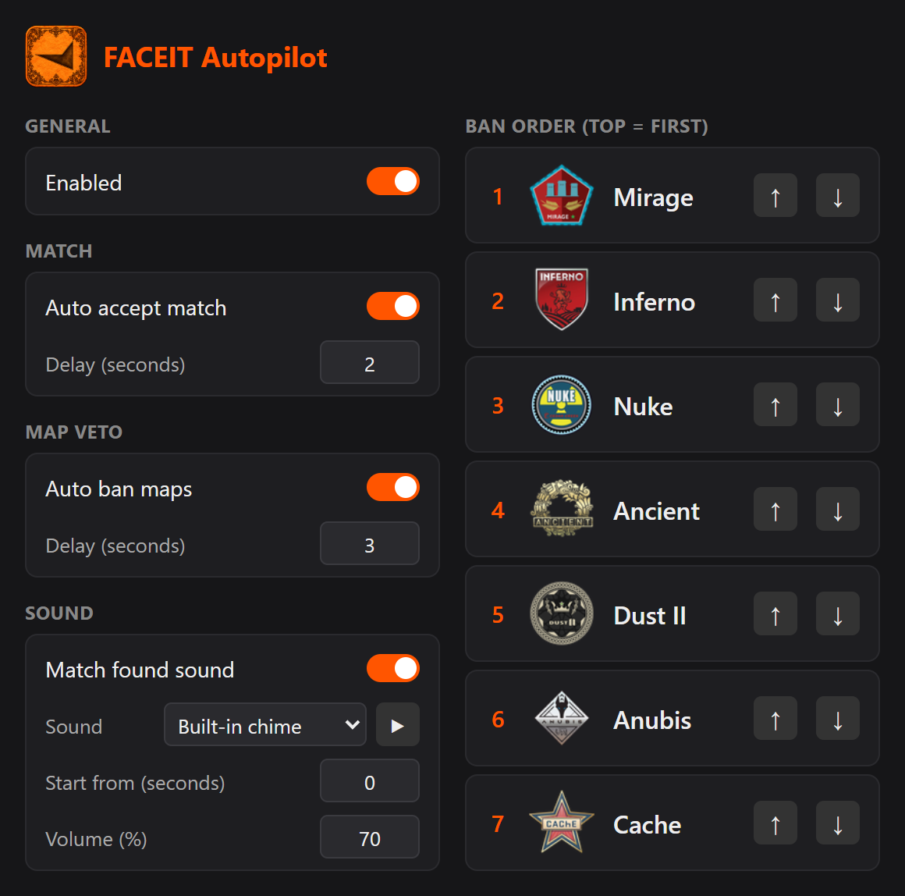
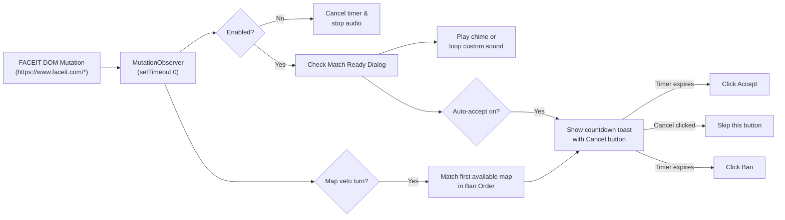

<div align="center">
  
  <h1>FACEIT Autopilot</h1>
  <p>Auto-accept FACEIT matches and auto-ban maps by your priority list.</p>
  <p>
    
    
    
    
  </p>
</div>

<p align="center">
  
</p>

<p align="center">
  <a href="#features">Features</a> •
  <a href="#screenshots">Screenshots</a> •
  <a href="#how-it-works">How it works</a> •
  <a href="#installation">Installation</a> •
  <a href="#usage">Usage</a> •
  <a href="#configuration">Configuration</a> •
  <a href="#troubleshooting">Troubleshooting</a>
</p>

## About

**FACEIT Autopilot** is a lightweight Chromium Manifest V3 extension that watches `https://www.faceit.com/*` for the "Match ready" prompt and CS2 map veto screen. It plays an alert sound (built-in chime or your own audio track), accepts matches after a configurable countdown, and bans maps in your chosen priority order—always showing an in-page **Cancel** toast before clicking anything. It requires only the `storage` permission and has zero build steps or external dependencies.

## Features

- **Auto-accept matches (multi-language):** Detects the "Match ready" dialog in 8 languages (English, German, French, Spanish, Portuguese, Polish, Russian, Turkish) and clicks Accept after a configurable delay (`0–20` s), even when the FACEIT tab is in the background.
- **Priority map auto-ban:** Watches the map veto list (ignoring server/region vetos), matches normalized map names (`de_` prefix and `II`/`2` handled automatically), and bans the highest-ranked available map on your turn. Maps not in your ban list are never banned.
- **Cancelable countdown toast:** Every scheduled accept or ban displays a bottom-right countdown notification (`Accepting match in 2s` / `Banning Mirage in 3s`) with a **Cancel** button to skip that turn. Actions also auto-cancel if the button disappears or becomes disabled.
- **Built-in chime or custom looping audio:** Plays a synthesized Web Audio chime when a match is found, or loops any audio file placed in `sounds/` (`.mp3`, `.wav`, `.ogg`, `.oga`, `.m4a`, `.aac`, `.flac`, `.webm`, `.opus`) starting from a chosen timestamp and fading out smoothly over `3.5` s once the match is accepted.
- **Synced settings & instant toggle:** Preferences sync across your browser profile via `chrome.storage.sync` and apply immediately without reloading FACEIT. Flipping **Enabled** off cancels any pending timer and stops active audio.

## Screenshots

<p align="center">
  
  <br /><em>Extension popup: configure delays, match-found sound, and map ban priority in one panel.</em>
</p>

## How it works



Because FACEIT is a React single-page app, `content.js` observes DOM mutations on `document.documentElement` and schedules scans with `setTimeout(..., 0)` (rather than `requestAnimationFrame`, which browsers throttle in background tabs). Settings stored in `chrome.storage.sync` are shared between `popup.js` and `content.js` via `defaults.js` and update live through `chrome.storage.onChanged`.

## Installation

### Requirements

- Any Chromium-based browser with Manifest V3 support (Google Chrome, Microsoft Edge, Brave, Opera, Vivaldi, etc.).

### Load as an unpacked extension

1. Clone or download this repository:
   ```bash
   git clone https://github.com/projectGloria/Faceit-Autopilot.git
   ```
2. Open your browser's extensions page:
   - Chrome: `chrome://extensions`
   - Edge: `edge://extensions`
   - Brave: `brave://extensions`
3. Enable **Developer mode** (toggle in the top-right or sidebar).
4. Click **Load unpacked** and select the `Faceit-Autopilot` folder (the directory containing `manifest.json`).
5. Pin **FACEIT Autopilot** to your toolbar for quick access.

## Usage

### 1. Set your map ban priority

Click the **FACEIT Autopilot** toolbar icon and use the `↑` and `↓` buttons in the **Ban order (top = first)** column to rank maps from most-wanted ban at the top to least-wanted at the bottom. Changes save immediately.

### 2. Add a custom match-found sound

1. Drop any supported audio file (`.mp3`, `.wav`, `.ogg`, `.oga`, `.m4a`, `.aac`, `.flac`, `.webm`, `.opus`) into the [`sounds/`](sounds/) folder (the repository includes `Hensonn - Galaxy.flac`).
2. Reload the extension on `chrome://extensions` if needed, then open the popup and pick the track from the **Sound** dropdown.
3. Optionally set **Start from (seconds)** (the track starts and loops from this timestamp) and **Volume (%)**, then click `▶` to preview (`■` to stop).

### 3. Cancel an upcoming action

When a match pops or your map veto turn starts, a dark toast with an orange border appears in the bottom-right corner of the FACEIT page. Click **Cancel** before the countdown reaches `0s` to skip that specific accept or ban without disabling the extension.

## Configuration

All defaults are defined in [`defaults.js`](defaults.js) and persisted to `chrome.storage.sync`.

| Setting | Default | Range / Options | Description |
| :--- | :--- | :--- | :--- |
| **Enabled** | `true` | On / Off | Master switch for all automation and sound alerts. |
| **Auto accept match** | `true` | On / Off | Automatically clicks Accept when the Match ready dialog appears. |
| **Accept delay** | `2` s | `0–20` s | Countdown before clicking Accept. |
| **Auto ban maps** | `true` | On / Off | Automatically bans maps during your team's map veto turn. |
| **Ban delay** | `3` s | `0–20` s | Countdown before clicking Ban. |
| **Match found sound** | `true` | On / Off | Plays audio when the Match ready dialog opens. |
| **Sound** | Built-in chime | Chime or any file in `sounds/` | Audio alert played on match found. |
| **Start from** | `0` s | `≥ 0` s (step `0.1`) | Start and loop point for custom audio files. |
| **Volume** | `70` % | `0–100` % | Playback volume for both the built-in chime and custom audio. |
| **Ban order** | Mirage, Inferno, Nuke, Ancient, Dust II, Anubis, Cache | Reorderable list | Priority order for map bans (top = banned first). |

<details>
<summary>Project structure</summary>

```text
Faceit-Autopilot/
├── manifest.json   # Manifest V3 config, storage permission, faceit.com match
├── defaults.js     # Shared default settings, chrome.storage.sync loader, Web Audio chime
├── content.js      # DOM observer, multi-language match detection, map veto logic, toast & audio
├── popup.html      # Extension popup UI and dark theme styles
├── popup.js        # Popup state binding, ban list reordering, /sounds scanner & preview
├── icons/          # Extension icons (16–128 px) and CS2 map icons
└── sounds/         # Custom match-found audio files
```

</details>

## Troubleshooting

<details>
<summary>Common issues</summary>

- **Custom sound does not play automatically:** Browsers block autoplay audio on a tab until you have interacted with the page at least once (for example, clicking Queue on FACEIT).
- **New audio file does not appear in the Sound dropdown:** Make sure the file is directly inside `sounds/` with a supported extension (`.mp3`, `.wav`, `.ogg`, `.oga`, `.m4a`, `.aac`, `.flac`, `.webm`, `.opus`), then close and reopen the popup.
- **Auto-accept or auto-ban stopped working after a FACEIT UI update:** FACEIT occasionally changes CSS class names. The selectors used to locate the Match ready dialog and map veto rows are grouped in the `SEL` object at the top of [`content.js`](content.js).

</details>

## Contributing

Issues and pull requests are welcome on [GitHub](https://github.com/projectGloria/Faceit-Autopilot). Since the extension has no build step, edit the files directly and click **Reload** on `chrome://extensions` to test your changes.

## License

<!-- TODO: Add a LICENSE file to the repository and update this section. -->
No `LICENSE` file is currently included in this repository.
